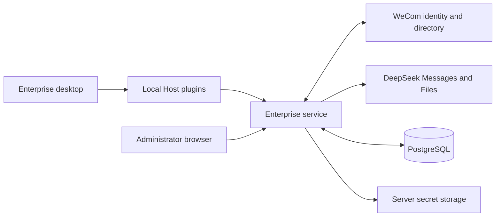
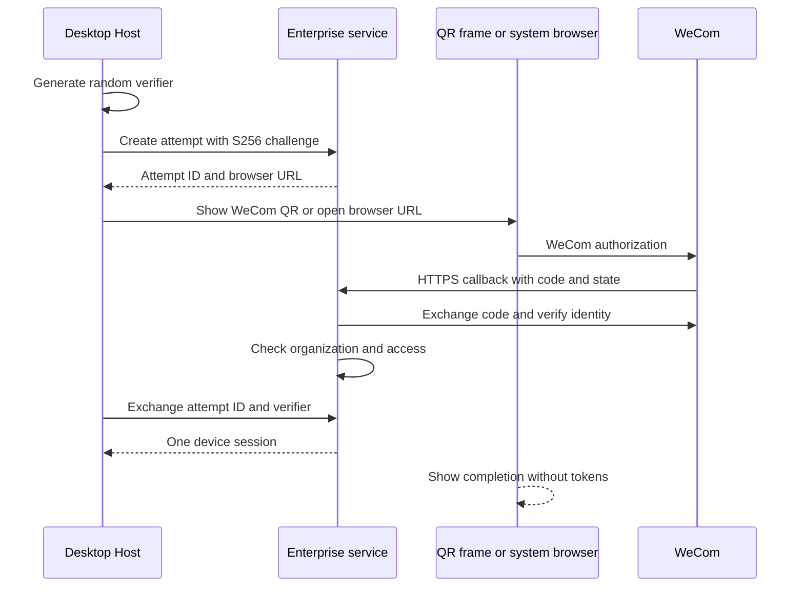

# Enterprise technical design

English | [中文](technical-design.zh.md)

## Summary

Use one independent enterprise service with desktop integration plugins and a small native distribution patch set. This reference specifies the proposed first-release behavior under the [design status](README.md); endpoint and table names below are planned interfaces.

## Table of Contents

- [Components and trust](#components)
- [Desktop authentication](#authentication)
- [Organization synchronization](#organization)
- [Policy resolution](#policies)
- [Messages and Files gateway](#gateway)
- [Quota ledger](#quota)
- [Data and APIs](#data-api)
- [Security and operations](#operations)

## Components and trust

| Component | Responsibility | Deployment |
| --- | --- | --- |
| Enterprise backend | Identity, organization jobs, policies, model proxy, ledger, and audit. | Company server, one TypeScript/Node.js service. |
| Admin website | Organization, access, policy, quota, and operational views. | React/Vite assets served at the backend origin. |
| Desktop identity plugin | Browser login transaction, refresh, signout, and Host-only credentials. | Employee local Host. |
| Desktop provider/UI plugins | Approved catalog, managed settings, and existing DeepSeek adapter wiring. | Local Host and Client faces. |
| Enterprise bundle and native patches | Composition, welcome UI, app identity, data isolation, and updates. | Enterprise desktop distribution. |

**Host plugin trust boundary:** Desktop Host plugins run in one Node process. The private process IPC channel is private from the renderer, but it does not isolate plugins from one another; any code loaded into that Host can issue identity storage and browser requests. The enterprise bundle declares approved Host entry packages as `dsh.enterprise.allowedHostPluginNames` in its release-owned package metadata. Desktop packaging binds each entry to its exact version and package path and seals the complete signed runtime package catalog into the runtime descriptor. The native launcher passes frozen copies through the Host process to `runProfile`; preflight checks composed rows, groups, and static Includes before activation, then recursively verifies declared dependencies, optional dependencies when present, and peer dependencies against that signed catalog. Unknown package code, same-name path/version substitutions, dependencies outside the catalog, and Includes that cannot be inspected are disabled. The policy still requires approval and real Loader composition evidence before release. The dependency check covers declared package metadata; it is not an OS sandbox for arbitrary dynamic loading. If the profile cannot enforce the policy, credentials must move behind a separately isolated broker.

The proposed server stack is TypeScript, a maintained Node.js LTS release, Fastify, PostgreSQL, and schema-validated HTTP interfaces. PostgreSQL owns transactions, synchronization staging, job leases, and the quota ledger. Pin exact supported dependency versions at implementation; validate their APIs before writing integration code.

Reuse [registerDeepSeekProvider](../../packages/llm/llm-deepseek/src/host.ts) for transport and discovery. The existing [connection admission](../../packages/client/connection/src/rpc-host.ts) uses one operator identity; the company service implements its own employee and administrator authorization. The first release runs no employee agent tasks on the central server.

Corporate credentials, quota, and authorization are server authorities. Desktop configuration and version headers are untrusted inputs. Minimum-version checks support compatibility, but do not attest that an unmanaged device runs unmodified software.

## Desktop authentication

Use an embedded WeCom QR login page or the system browser with the company registered HTTPS callback. WeCom authenticates the employee; the company backend issues its own device session. The desktop handoff proof below is owned by this system and does not depend on WeCom implementing OIDC or PKCE.

For browser login, use the [WeCom Web login](https://developer.work.weixin.qq.com/document/path/98152) CorpApp endpoint `https://login.work.weixin.qq.com/wwlogin/sso/login` with the configured app, callback and state. The QR view uses WeCom's `https://open.work.weixin.qq.com/wwopen/sso/qrConnect` with the same four validated parameters and `self_redirect=true`, isolated in a sandboxed frame; the Host retains the verifier and polls the same attempt every 2.5 seconds. The callback accepts WeCom's optional `appid` only when it equals the configured company ID. If the QR page instead tries to navigate the top frame to the HTTPS callback, the native window blocks that navigation and forwards only a callback matching the current attempt's registered origin, path, state and app ID; the local welcome page remains open to observe completion. Exchange the code through [auth/getuserinfo](https://developer.work.weixin.qq.com/document/path/98176) and read `userid`; identity success alone does not establish application visibility, so the active authorized organization snapshot must still admit that employee.

- Generate at least 256 bits of verifier entropy on the Host. Store its S256 challenge with an unpredictable attempt ID, hashed state, creation time, and configured company/application. Accept only registered browser/callback destinations.
- An attempt expires after five minutes. Callback state validation and code exchange must be single-owner operations. Duplicate callbacks cannot change the approved identity. Cancelled, expired, denied, and consumed attempts cannot mint sessions.
- Verify the resulting company and user identity, application authorization, active directory snapshot, and employee status on the server. Identity is keyed by company plus WeCom UserID; email and phone never merge accounts.
- Include the verified company ID and employee ID in every successful desktop redemption and refresh response so the Host can publish identity status and bind its runtime space; keep all token fields inside the Host.
- The Host polls or exchanges with the verifier in an HTTPS request body. Pending attempts return 202; an approved attempt has a 60-second redemption window and is atomically consumed once. Tokens never appear in callback URLs. Retain a consumed attempt challenge for a ten-minute cleanup window: a verifier-protected cleanup operation can revoke only the session created by that attempt, cannot mint or recover tokens, and is rate-limited. A lost token response uses this cleanup before a fresh login.
- Access tokens last five minutes; refresh sessions have a seven-day absolute lifetime. Store refresh-token hashes server-side, rotate on refresh, and revoke the device session on confirmed reuse. Serialize refresh on the Host to prevent legitimate parallel calls from reusing a rotated token. Restore from Keychain only when the stored session pair matches the trusted company and employee returned by the backend.
- Keep refresh credentials in macOS Keychain-backed storage and access tokens in Host memory. Issue a separate 256-bit logout-only capability per device session; the server stores its hash and it can revoke only that session, never refresh or infer. The renderer receives only identity/status. Offline logout clears active credentials and retains only this encrypted capability in a durable revocation queue; reconnect or app restart retries it idempotently, then deletes it. Display pending revocation until confirmed or the server session expires.

Administrator browser login uses a separate server session in a Secure, HttpOnly, SameSite cookie. Protect state-changing admin requests with CSRF checks and origin validation. Bootstrap administrator UserIDs through deployment configuration; the first employee login never becomes an administrator automatically.

Partition local conversation storage, credential references, and upload caches by the verified company/employee identity inside the enterprise application data root. The native launcher derives each employee space from the trusted company ID and employee ID, sets `DSH_HOME` to that space, and starts Host with `DSH_ENTERPRISE_IDENTITY_SPACE` bound to the same identity. The bootstrap space has no identity and cannot return model access tokens.

Identity changes run as one native transaction: clear old forwarding and transient state, stop the old Host, prepare the target profile, start Host, then reload the shell. Host events carry the current Host epoch; events from a stopped epoch are discarded, and the admission fence rejects traffic until the target identity is ready. The coordinator does not roll back to the old Host after a failed start, so retry starts from a clean transaction owner.

The main renderer uses `session.fromPath(join(space.home, 'browser-session'))` for the active employee. Switching identity destroys the old window and constructs a new window with the target Session; localStorage drafts and browser state are therefore scoped by employee space. Returning from A to B and back to A reopens A's own stored state, while guest partitions reset on switch and are not reused across employees.

Identity changes close the current Host and start a separate employee profile/home; never submit an earlier employee history under the new identity. This is application-level separation, not protection from an OS account owner reading files directly.

## Organization synchronization

Read only the self-built application authorized directory, including departments, parent relationships, employees, and multiple memberships. Name, avatar, manager, phone, and email fields depend on actual permissions; sync must work without optional personal fields. A direct-manager tree is not assumed from the department tree.

- Create a sync epoch and staging rows. Fetch all authorized roots, departments, member pages, and relations with bounded retries and rate limits. A company-level database lease prevents overlapping publication.
- Validate tree acyclicity, parent references, membership references, pagination completion, expected roots, scope identity, and count changes. A reduction exceeding 20 percent, an unexplained authorization change, or an unverifiable scope requires administrator confirmation.
- Publish only a complete validated authorized snapshot by switching the active epoch in one transaction. Partial, failed, expired-lease, or interrupted jobs leave the last valid snapshot unchanged and do not delete absent employees.
- Confirmed absent or disabled employees lose access during publication. Manual disablement persists across sync and always wins over directory reactivation. Unconfirmed scope reduction freezes the affected access until reviewed; it is not silently interpreted as employee departure.
- Run full authorized-scope synchronization every 15 minutes, with a manual trigger and a login-time membership check where supported. Access requires a valid snapshot no older than 60 minutes. Initial access remains closed until the first snapshot publishes.
- Treat directory callbacks as an optional later optimization after verifying the actual app permissions. Validate signature/decryption, deduplicate, and request resync; polling remains the first-release source of completeness.

Each employee needs one server-owned cost department that is a current membership. Use an approved main-department field only when its availability is verified; otherwise the administrator assigns it. A missing or departed cost department blocks inference until corrected. Charge completed requests to the cost-department snapshot captured at admission.

## Policy resolution

Resolve the effective catalog as the intersection of the company allowlist, every explicit restriction on the employee membership departments and their ancestors, and an explicit employee restriction. Omitted restrictions inherit; an empty allowlist denies all. Any applicable disablement wins. Personal preferences never expand access.

Choose the default from the employee preference, cost-department default, company default, and company-ordered fallback list, accepting the first permitted entry. If none is permitted, block inference with the explanation. Reject a submitted disallowed model rather than substituting another one.

Resolve output and reasoning limits using the most restrictive applicable cap. Policy writes require the expected revision; stale writes return 409. Admission reads the authoritative active policy and employee state inside the budget transaction and records their revisions. Cached desktop policy controls presentation only.

New requests fail immediately after a committed revocation or deny change. Recheck active-stream revocation at most every five seconds and abort affected upstream calls. Broader settings edits apply to the next request; the in-flight request retains its admitted model, token cap, budget period, and price revision.

## Messages and Files gateway

The current [adapter](../../packages/llm/llm-deepseek/src/adapter.ts) posts to the Messages root, not a generic model gateway. Set the enterprise provider base URL to a company-owned HTTPS root ending in `/inference/deepseek/v1`; the existing [root resolver](../../packages/llm/llm-deepseek/src/messages-api.ts) then appends resource names without a second `/v1`.

| Route | Behavior |
| --- | --- |
| `POST /inference/deepseek/v1/messages` | Authenticate employee, validate model/body/file ownership, reserve quota, and relay the Messages stream. |
| `POST /inference/deepseek/v1/files` | Authenticate, enforce upload/media/expiry limits, and persist employee ownership before returning a usable file ID. |
| `GET /inference/deepseek/v1/files` | Return only the caller owned files with ownership-filtered pagination. |
| `GET` / `DELETE /inference/deepseek/v1/files/{id}` | Check employee ownership; return 404 for foreign/unknown IDs and forward only authorized operations. |

Use employee Bearer credentials only between Host and enterprise service. Strip incoming upstream-auth and identity headers, derive employee identity from the session, and inject the server DeepSeek credential toward the configured official origin. Allow only qualified Messages/Files paths, methods, beta/version headers, and body fields; prohibit arbitrary URLs, redirects, and unsupported resources.

Relay Messages SSE incrementally with backpressure and cancellation. Preserve text, thinking/signatures, tool blocks, tool changes, stop reasons, and usage. A bounded side parser reads raw `message_start` and `message_delta` usage and terminal `message_stop`; cumulative output usage replaces prior cumulative values. Settle only if an actual final output count is present, is a nonnegative integer, never decreases, stays within the reservation, and accompanies a qualified terminal sequence. Missing/malformed output or a fallback zero from the adapter is not trusted usage. Protocol violations stay uncertain; an output-bound violation disables the affected model pending review.

Before stream headers, return structured protocol-compatible 400/401/403/409/413/429/502/503 failures. After headers, relay a valid protocol error where possible and terminate the stream; never append an unrelated admin JSON envelope. The gateway performs no automatic replay after dispatch; retries by Harness are separate budgeted attempts and may incur separate upstream charges.

Every `file_id` in Messages must belong to the authenticated employee, including references in historical messages. Shared upstream credentials never authorize cross-employee list/retrieve/delete. Filename prefixes are not proof of ownership; this matters because the current [file store](../../packages/llm/llm-deepseek/src/file-store.ts) can reclaim uploaded files. Unknown post-upload outcomes enter cleanup reconciliation without exposing orphaned files.

The current local upload cache is scoped by endpoint and authentication headers. Token refresh can create a different cache scope; first-release behavior allows safe reupload and server expiry cleanup. It does not promise cache reuse across employee sessions or token rotation.

## Quota ledger

Use integer output-token units for hard quotas. Require configured finite company, employee, and cost-department/ancestor limits for each calendar month in the company timezone. Create period buckets atomically from approved quota configuration on first admission. The request freezes its period and cost department. Reject a limit reduction below settled usage plus active reservations with 409 under the same budget locks. Input tokens and estimated money are reporting fields, not hard monetary enforcement.

- In one database transaction, lock relevant employee/policy and budget rows in deterministic order, check active sessions and directory freshness, check the two-call concurrency limit, and reserve the enforced maximum output. Available quota equals limit minus settled usage minus active reservations.
- The actual upstream protocol/model must enforce the reserved output bound, including reasoning. If qualification cannot establish that bound, do not enable that model/capability. Do not shrink a request silently; the client must submit within the advertised cap.
- Persist request states `reserved`, `dispatched`, `settled`, and `uncertain`. Mark dispatched durably before initiating network delivery. Release immediately only when dispatch is provably absent; a crash in the delivery window is uncertain.
- On trusted terminal usage meeting the gateway validation above, settle once by unique request ID, debit actual output, and release the difference. Do not use the local adapter default usage as accounting evidence. Capture qualified input/cache/output statistics and the price revision separately; missing input/cache data makes the corresponding cost unavailable or explicitly estimated. Missing terminal output, cancellation, disconnection, or service crash cannot establish zero charge.
- Keep uncertain reservations visible. At 24 hours, a reconciliation job converts the reserved amount to an explicitly estimated debit; trusted later evidence can produce one audited adjustment. Expiry alone never silently refunds dispatched work.
- Use a server request ID for each attempt. An optional client idempotency key is bound to employee and body digest; different content returns 409. A repeated dispatched attempt returns its status, not a new model execution or an invented stream resume.

Start with a ten-minute total inference deadline, model-qualified output caps, bounded request size, and bounded file expiry. Worker leases and uniqueness constraints recover reservations after process loss. A price revision is immutable for an admitted request; absent price data leaves cost explicitly unavailable rather than zero.

## Data and APIs

| Data owner | Planned records and invariants |
| --- | --- |
| Identity | `companies`, `employees`, `device_sessions`, `login_attempts`; unique company/UserID, hashed refresh credentials, manual disable state. |
| Organization | `departments`, `memberships`, `sync_runs`, `organization_epochs`; staged snapshots and one active epoch. |
| Policy | `policy_revisions`, `model_catalog`, `cost_assignments`; optimistic concurrency and validated defaults/caps. |
| Quota and inference | `budget_buckets`, `inference_requests`, `usage_ledger`, `price_revisions`; unique settlement/adjustment and request snapshots. |
| Files and operations | `upstream_files`, `job_leases`, `audit_events`; employee ownership, cleanup state, privileged audit. |

| API group | Planned interface and access |
| --- | --- |
| Desktop auth | `POST /api/enterprise/v1/auth/desktop/attempts`; verifier-protected status/exchange/cancel and consumed-attempt cleanup; rate-limited public entry. |
| Sessions | `POST /api/enterprise/v1/auth/refresh`, `/auth/logout`, `/auth/revoke-device`; normal revocation uses the session, offline retries use a logout-only capability. |
| Employee data | `GET /api/enterprise/v1/me`, `/me/policy`, `/me/usage`, `/capabilities`; session-derived identity and supported versions. |
| Administration | `/api/enterprise/v1/admin/organization`, `/employees`, `/policies`, `/budgets`, `/usage`, `/audit`; explicit administrator authorization. |
| Sync jobs | `POST /api/enterprise/v1/admin/sync-runs` returns 202 and a job ID; status is separate from success. |

Non-inference JSON uses `{ success, data, error, requestId }`, with structured `error.code`, safe message, and pagination where relevant. API v1 additions are backward compatible; incompatible changes require a new major version and a defined overlap window. Inference retains its upstream-compatible wire format.

## Security and operations

- Validate HTTP, durable data, deployment configuration, and upstream responses. Enforce HTTPS, method/path allowlists, upload limits, admin CSRF, rate limits, and parameterized SQL. Redact credentials and model content from logs, traces, and errors.
- Disable official session-log contribution and optional product analytics in the enterprise composition. The backend rejects or strips `dsh_session_log` and unapproved metadata. Required inference context still reaches DeepSeek; local tools remain governed by Harness permissions.
- Keep full conversations local by default. Store operational/accounting metadata centrally; export security changes to an independently retained audit/recovery record. File bytes stream to the approved upstream and expire there. Retention and deletion requirements are deployment inputs, not implicit provider guarantees.
- Expose liveness/readiness, directory age, pending/failed jobs, revocation lag, relay latency, upstream failures, and uncertain ledger totals. Database or authoritative-policy failure refuses new admissions; local chat history remains accessible.

## Dev Note

Real credentials must qualify Messages beta headers, Files response schema and expiry, model output bounds, and usage semantics. Chat Completions support requires a separate scope decision and cannot replace these qualification cases. [Delivery](delivery-and-upstream.md) owns deployment and recovery choices.

Before a public callback domain exists, an explicit local simulation process may use HTTP only on canonical `127.0.0.1` with a temporary database and synthetic company/employees. It must not read real credentials or call live WeCom/models, must use distinct development cookie names with state/origin/CSRF checks, and must not modify OS trust or bypass TLS validation. Production entrypoints retain HTTPS and `__Host-*; Secure` cookies; this simulation is not live qualification.
