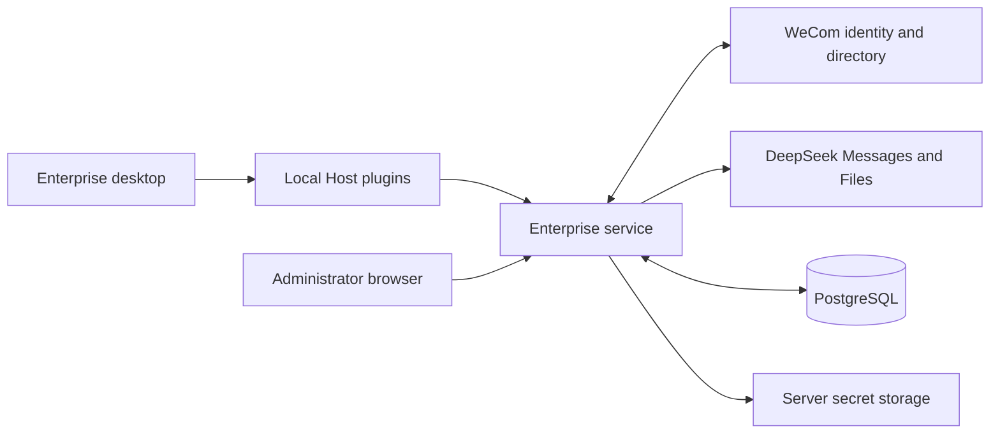
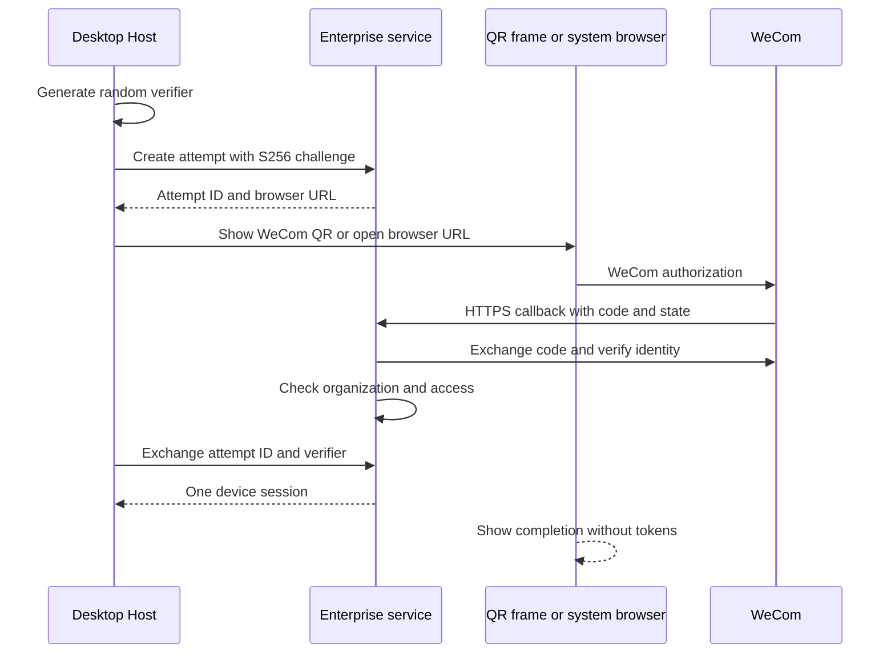

# 企业版技术设计

[English](technical-design.md) | 中文

## 摘要

采用独立企业服务、桌面集成插件与少量原生发行补丁。本参考在[设计状态](README.zh.md)下规定首期拟实现行为；以下接口及表名均为规划接口。

## 目录

- [组件与信任](#components)
- [桌面认证](#authentication)
- [组织同步](#organization)
- [策略解析](#policies)
- [Messages 与 Files 网关](#gateway)
- [额度账本](#quota)
- [数据与接口](#data-api)
- [安全与运维](#operations)

## 组件与信任

| 组件 | 职责 | 部署位置 |
| --- | --- | --- |
| 企业后端 | 身份、组织任务、策略、模型代理、账本及审计。 | 企业服务器，一个 TypeScript/Node.js 服务。 |
| 管理网页 | 组织、权限、策略、额度和运维视图。 | React/Vite 产物，由后端同源提供。 |
| 桌面身份插件 | 浏览器登录事务、刷新、退出及仅 Host 可访问的凭据。 | 员工本地 Host。 |
| 桌面模型及 UI 插件 | 授权模型目录、受管设置及现有 DeepSeek 适配器接入。 | 本地 Host 与 Client 两侧。 |
| 企业组合包与原生补丁 | 插件组合、欢迎界面、应用标识、数据隔离及更新。 | 企业桌面发行版。 |

**Host 插件信任边界：** Desktop Host 插件在同一个 Node 进程中运行。私有进程 IPC 可隔离 renderer，但不能隔离插件；所有加载到该 Host 的代码都能发起身份存储和浏览器请求。企业组合包通过发行版包元数据字段 `dsh.enterprise.allowedHostPluginNames` 声明获准的 Host 入口包。Desktop 打包将入口包绑定到准确版本和路径，并把完整签名运行包目录封入运行时描述文件。原生启动器将冻结副本经 Host 子进程传给 `runProfile`；预检在激活前检查组合条目、group 和静态 Include，再递归核对声明的依赖、已安装的可选依赖及 peer 依赖是否均属于该签名目录。同名替换、目录外依赖、未知包代码及无法检查的 Include 会被禁用。此策略仍需审批，并在发布前提供真实 Loader 组合证据。依赖检查覆盖包元数据声明，不构成对任意动态加载的操作系统沙箱。如果企业 profile 无法执行该策略，必须改为由独立隔离 broker 管理凭据。

服务端拟采用 TypeScript、受维护的 Node.js LTS、Fastify、PostgreSQL 及 schema 校验的 HTTP 接口。PostgreSQL 承担事务、同步暂存、任务租约与额度账本。实现时固定受支持的依赖版本，编写集成代码前核对对应 API。

通过 [registerDeepSeekProvider](../../packages/llm/llm-deepseek/src/host.ts)复用传输与发现。现有[连接接纳](../../packages/client/connection/src/rpc-host.ts)使用单一操作者身份；企业服务单独实现员工与管理员授权。首期员工 agent（智能体）任务由本地执行。

`deepseek-enterprise` 路由的企业凭据、额度与授权以服务端为准。桌面配置及版本头均为不可信输入。员工自有路由使用本地凭据，不在企业网关计量和撤销范围内。最低版本检查用于兼容管理，无法证明未受管设备运行的是未修改软件。

## 桌面认证

使用页面内企业微信二维码或系统浏览器，并使用企业登记的 HTTPS 回调。企业微信验证员工身份，企业后端签发自己的设备会话。以下桌面交接证明由本系统定义，不依赖企业微信实现 OIDC 或 PKCE。

浏览器登录使用[企业微信 Web 登录](https://developer.work.weixin.qq.com/document/path/98152)的 CorpApp 入口 `https://login.work.weixin.qq.com/wwlogin/sso/login`，传入登记的应用、回调和 state。二维码视图以相同的四项已校验参数及 `self_redirect=true` 打开企业微信 `https://open.work.weixin.qq.com/wwopen/sso/qrConnect`，将页面隔离在沙箱 frame 中；Host 保留 verifier，每 2.5 秒查询同一次尝试。回调可接受企业微信附加的 `appid`，但必须与配置的企业 ID 一致。若二维码页面仍试图将顶层窗口导航到 HTTPS 回调，原生窗口会阻止导航，只转发与当前尝试登记的源、路径、state 和企业 ID 完全匹配的回调，让欢迎页保持打开以观察完成状态。通过 [auth/getuserinfo](https://developer.work.weixin.qq.com/document/path/98176) 兑换 code 并读取 `userid`；身份成功并不代表处于应用可见范围，仍须由当前授权组织快照决定员工准入。

- Host 生成至少 256 位熵的 verifier；将 S256 challenge 与不可预测的尝试标识、state 哈希、创建时间及配置的企业和应用绑定。仅接受登记的浏览器入口和回调目的地。
- 尝试在五分钟后过期。回调 state 校验及 code 交换须由单一执行者处理；重复回调不能改变已批准身份；已取消、过期、拒绝及已消费的尝试均不能签发会话。
- 服务端校验所得企业及用户身份、应用授权、有效组织快照和员工状态。身份键为企业加企业微信 UserID；邮箱和手机号不用于合并账号。
- 每次成功的桌面兑换和刷新响应均包含已验证的企业 ID 与员工 ID，供 Host 发布身份状态并绑定运行空间；所有令牌字段仅留在 Host 内。
- Host 将 verifier 放入 HTTPS 请求体，轮询或交换尝试状态。待授权返回 202；已授权尝试有 60 秒兑换窗口且只能原子消费一次。令牌不进入回调 URL。已消费尝试的 challenge 保留十分钟清理窗口：证明保护的清理操作仅可撤销该尝试创建的会话，不能签发或取回令牌，并须限流。令牌响应丢失时先执行此清理，再重新登录。
- 访问令牌有效期五分钟；刷新会话绝对有效期七天。服务端保存刷新令牌哈希，每次刷新轮换，确认重用后撤销设备会话。Host 串行刷新，避免合法并行调用重用已轮换令牌。仅当操作系统加密存储中的会话 pair 与后端返回的可信企业及员工一致时，才可恢复会话。
- 刷新凭据使用 macOS Keychain 支持的存储；Windows x64 开发包使用 Electron safeStorage 提供的 Windows DPAPI 加密，访问令牌置于 Host 内存。Windows DPAPI 区分系统用户，但不隔离同一 Windows 用户下的其他进程，因此发行资格须复核 Host 插件白名单与同用户威胁模型。每个设备会话另签发一个 256 位仅退出能力凭据，服务端保存哈希；它只能撤销该会话，不能刷新或推理。渲染侧仅接收身份与状态。离线退出清除活动凭据，仅将此加密能力凭据保留在持久撤销队列；恢复连接或重启应用后幂等重试，完成后删除。在确认撤销或服务端会话过期前，展示待撤销状态。

管理员浏览器登录使用独立服务端会话，置于 Secure、HttpOnly、SameSite=Strict Cookie 中。企业微信回调先按有效授权组织快照核对员工，再检查角色；普通员工不会获得管理会话。签发管理员或首位所有者初始化 Cookie 后，回调先返回登记域名上的 no-store 完成页，再由该页面导航到后台，结束企业微信的跨站重定向链后才要求浏览器携带 Strict Cookie。完成页不包含 code、token、state 或员工数据，自动跳转不可用时提供同源继续链接。管理写请求须校验 CSRF、来源及限流，每次管理请求都重新核对员工仍有效及当前授权。

明确的服务端命令为指定且有效、位于授权范围内的企业微信 UserID 生成密码学随机、十分钟有效的一次性初始化口令，并仅在命令终端显示一次；重新生成会使旧口令失效。仅保存口令摘要、到期时间、绑定身份及持久化尝试次数。在企业从未初始化时，该身份扫码成功后仅取得短期待设置会话，不取得管理会话。提交口令的事务锁定单企业初始化记录，校验身份、期限及尝试上限，消耗口令、建立首位所有者授权并记录审计；并发提交不能建立第二位首位所有者。即使日后所有者全部丢失，也不能重启初始化。

所有者可按稳定的企业与 UserID 及预期授权版本授予、调整或撤销所有者和管理员角色。禁止撤销或降级最后一位有效所有者；授权变化后立即撤销受影响的管理会话，并审计操作者、目标、前后角色及结果，但不记录口令。管理员可管理组织、模型策略、额度及报表，只有所有者可管理授权与提供方凭据。全部所有者丢失后的恢复须使用独立的运维命令，注明原因并记录审计，不自动返回初始化流程。旧 `ADMIN_BOOTSTRAP_USER_IDS` 的导入需明确的运维核对步骤，不能静默赋权。

在企业应用数据根目录内，按已校验的企业及员工身份隔离本地对话、凭据引用和上传缓存。原生启动器从可信企业 ID 与员工 ID 推导每个员工空间，将 `DSH_HOME` 指向该空间，并以同一身份绑定 `DSH_ENTERPRISE_IDENTITY_SPACE` 启动 Host。bootstrap 空间没有身份，不能返回模型访问令牌。

多个独立的单企业部署可以共用源码，并为每个客户端提供不含密钥的打包配置。配置在打包前固定服务 HTTPS 地址、反向域名应用 ID、产品名称与外部应用唤起 URL 协议。应用 ID 决定 Electron 数据根目录；安装包注册该配置的外部协议，打包清单向启动器提供相同的值。不同的 ID、名称与协议使客户端可以共存，避免共用凭据或应用唤起注册。自定义应用 ID 还将更新目录隔离在 `dsh-enterprise/<appId>/` 下，临时客户端保留旧路径。企业微信授权的 HTTPS 回调仍由各自后台配置，与该应用唤起协议无关。企业微信 Secret、模型密钥、签名凭据与更新策略属于各自服务端或受保护构建设置，不进入该配置。 相邻企业仓库维护[企业配置流程](../../../deepseek-harness-enterprise/docs/company-configuration.md)，为每个独立部署生成公开服务设置、受保护文件引用和客户端配置。

身份切换作为一个原生事务执行：清理旧转发及临时状态、停止旧 Host、准备目标 profile、启动 Host，然后重新加载 shell。Host 事件携带当前 Host epoch；已停止 epoch 的事件会被丢弃，准入 fence 在目标身份就绪前拒绝流量。coordinator 在启动失败后不回滚到旧 Host，因此重试由干净的事务 owner 开始。

主 renderer 对当前员工使用 `session.fromPath(join(space.home, 'browser-session'))`。切换身份时销毁旧窗口，并使用目标 Session 创建新窗口；localStorage 草稿和浏览器状态因此按员工空间保存。从 A 切到 B 再回到 A 会重新打开 A 自己的状态，而 guest partition 在切换时重置，不跨员工复用。

身份切换时关闭当前 Host，启动独立员工 profile 与 home；不得以新身份提交上一员工的历史。这属于应用层隔离，不防御系统账号所有者直接读取文件。

## 组织同步

仅读取自建应用获授权的通讯录，包括部门、父子关系、员工及多部门归属。姓名、头像、负责人、手机号和邮箱取决于实际权限；缺少可选个人字段不应阻止同步。部门树不等同于直属汇报树。

- 创建同步 epoch 与暂存数据；按限次重试和限流规则读取全部授权根节点、部门、成员分页及关系。企业级数据库租约阻止重叠发布。
- 校验部门树无环、父节点引用、成员关系引用、分页完整性、预期根节点、范围标识及数量变化。数量下降超过 20%、授权变化无法解释或范围无法验证时，须由管理员确认。
- 仅将完整且校验通过的授权快照在一个事务中切换为有效 epoch。部分、失败、租约过期及中断任务保留上次有效快照，不删除本次未出现的员工。
- 发布时回收已确认缺失或停用员工的访问。人工停用状态跨同步保留，优先于组织重新激活。未确认的范围收缩先冻结受影响访问，等待评审，不静默认定为员工离职。
- 每 15 分钟执行一次授权范围全量同步，提供手动触发，并在接口支持时执行登录时成员复核。访问要求有效快照不超过 60 分钟；首次快照发布前不开放使用。
- 通讯录回调在确认实际应用权限后作为后续优化。回调须验签、解密、去重并触发重同步；首期通过轮询保证完整性。

每名员工必须有一个由服务端管理且属于当前成员关系的成本部门。主部门字段仅在可用性验证后采用，否则由管理员指定。成本部门缺失或已失效时阻止调用，直到修正。已完成请求归集到接纳时记录的成本部门快照。

## 策略解析

最终模型目录取企业允许列表、员工所属部门及其祖先上所有显式限制、员工显式限制的交集。未配置限制表示继承，空允许列表表示全部拒绝。任何适用的停用规则优先。个人偏好不能扩大权限。

依次检查员工偏好、成本部门默认、企业默认及企业有序备用列表，选择首个获准项；不存在获准项时阻止调用并解释原因。请求提交了不允许模型时予以拒绝，不替换为其他模型。

输出和推理限制取所有适用上限中最严格者。策略写入须携带预期版本，过时写入返回 409。接纳在预算事务内读取权威有效策略与员工状态，并记录对应版本。桌面缓存策略仅用于展示。

撤权或拒绝规则变更提交后立即拒绝新的请求；至少每五秒复核一次活动流的撤权状态，并终止受影响的上游调用。其他设置变更作用于后续请求；进行中的请求保留接纳时的模型、token 上限、预算周期及价格版本。

## Messages 与 Files 网关

当前[适配器](../../packages/llm/llm-deepseek/src/adapter.ts)向 Messages 根路径发送请求。企业模型提供方的 base URL 设为企业 HTTPS 根路径，以 `/inference/deepseek/v1` 结尾；现有[根路径解析器](../../packages/llm/llm-deepseek/src/messages-api.ts)随后附加资源名，不重复添加 `/v1`。

| 路由 | 行为 |
| --- | --- |
| `POST /inference/deepseek/v1/messages` | 认证员工、校验模型和请求体及文件归属、预留额度并转发 Messages 流。 |
| `POST /inference/deepseek/v1/files` | 认证并限制上传、媒体及过期参数，在返回可用文件 ID 前持久化员工所有权。 |
| `GET /inference/deepseek/v1/files` | 仅返回调用者拥有的文件，并在所有权过滤后正确分页。 |
| `GET` / `DELETE /inference/deepseek/v1/files/{id}` | 校验员工所有权；他人或未知 ID 返回 404，仅转发获授权操作。 |
| `POST /inference/compatible/v1/chat/completions` | 认证员工、解析已发布的兼容提供方与模型、预留输出额度并转发获资格的 Chat Completions SSE。 |
| `GET /api/enterprise/v1/me/compatible-models` | 仅返回当前设备会话获准使用且已发布的兼容模型，不返回提供方凭据。 |

员工 Bearer 凭据仅用于 Host 与企业服务之间。移除传入的上游认证及身份头，从会话推导员工身份，向配置的官方源注入服务端 DeepSeek 凭据。仅允许已验证的 Messages/Files 路径、方法、beta 及版本头和请求字段；禁止任意 URL、重定向及不支持资源。

DeepSeek 提供方目录仅允许有真实 Messages/Files 及输出上界资格记录的模型；首个获准模型是 `deepseek-flash`。兼容提供方目录另需完成 Chat Completions 及输出用量资格验证。管理员策略不能创建未经验证的模型 ID。原生“模型”页同时加载可由员工配置的提供方适配器，其本地设置和凭据不能配置没有可写设置命名空间的 `deepseek-enterprise` 路由；企业只读分组列出当前员工可用的模型名称，没有编辑或企业密钥字段。企业策略及额度明细留在管理后台。企业与个人路由在选择器中保持独立。所有者通过只写管理请求更换上游 API Key：每个不可变密钥版本使用由受保护服务器文件提供的独立主密钥加密，读取接口仅返回配置状态及版本信息，不在读取响应、日志或审计中输出明文。新企业请求接纳时固定密钥版本，轮换不改变已派发调用。文件保存创建时的密钥版本；旧加密版本保留至所属文件及清理任务不再需要，再通过受审计操作退役。未配置密钥时，管理网页继续可用，企业推理在派发前以明确的不可用结果失败。

后台“模型与策略”视图把已获资格的提供方呈现为卡片，列出启用模型名称、密钥状态及卡片内模型编辑器。它还允许保存 OpenAI 兼容提供方草稿，要求经过校验的公网 HTTPS Base URL、明确的模型 ID，以及只写并加密的密钥。草稿使用独立的提供方与密钥版本记录、角色校验、版本化写入及审计事件；保存后卡片列出模型名称。所有者只能发布绑定精确提供方版本、地址、模型列表和密钥版本的已复核资格记录；绑定发生变化时提供方回到待接入状态。员工目录及推理网关均不读取未获资格的草稿。策略编辑是独立且绑定范围的卡片，表单和 JSON 模式共享一份草稿；表单修改保留未暴露的字段。写入前必须确认当前范围路径和版本与已读取记录一致，冲突时保留草稿。预览值使用文本节点渲染，原始约束记录放入可展开区域。浏览器不将提供方响应插入 HTML，也不接收明文密钥。

首个兼容资格对象为 `qwen3.8-omni-flash`，地址为 `https://llm-8w9jc1k1ro7fi2ml.cn-beijing.maas.aliyuncs.com/compatible-mode/v1`。网关固定该 HTTPS 目标和模型 ID，拒绝重定向与私网解析，并在 TLS 连接中固定已核对的公网地址。仅接受 Chat Completions 文本和工具调用，设置 `stream=true` 与 `stream_options.include_usage=true`，并把 `max_tokens` 限制在企业公布的 4,096 token 上限内。试点请求还受 8 KiB JSON 大小、五分钟总时限、滚动 24 小时每员工 30 次及全企业 200 次限流和输出 token 额度限制。图片、音频、视频、任意端点及未获资格的模型 ID 均被拒绝。服务端在设备认证及策略和额度接纳后注入加密保存的提供方密钥，员工客户端不接触密钥。有界解析器仅接受一次带非负整数 `completion_tokens` 的终态用量事件，随后收到 `[DONE]`；缺失、重复、畸形或超过预留的用量使已派发预留保持不确定。上游停止原因 `stop` 不代表流内没有 `delta.tool_calls`。兼容路由目前在管理报表中仅估算输出费用，输入费用须对照账单。企业仓库中单独的 ENT-050 资格记录仅覆盖实际提供方行为，不代表桌面或部署验收。

以背压及取消支持逐步转发 Messages SSE（Server-Sent Events）。保留文本、思考及签名、工具块、工具变化、停止原因与用量。有界旁路解析器读取原始 `message_start`、`message_delta` 用量及终止 `message_stop`，累计输出用量覆盖先前累计值。仅当实际最终输出计数存在、为非负整数、不回退、不超过预留且伴随已验证终态序列时结算。缺失或畸形输出、适配器补出的零值均不属于可信用量。协议异常保持不确定状态；输出上界被突破时停用受影响模型并待评审。

发送流响应头前，返回协议兼容的结构化 400、401、403、409、413、429、502 或 503 错误。发送响应头后，尽可能转发合法协议错误并终止流，不附加无关管理 JSON 包装。网关派发后不自动重放；Harness 发起的重试是独立计量尝试，可能分别产生上游费用。

Messages 中每个 `file_id` 均须属于当前认证员工，包括历史消息内的引用。共享上游凭据不授予跨员工的列表、读取或删除权限。文件名前缀不是所有权证明；现有[文件存储](../../packages/llm/llm-deepseek/src/file-store.ts)会回收上传文件，因此必须执行此限制。上传后结果未知的文件进入清理对账，不暴露遗留文件。

当前本地上传缓存按端点和认证头隔离；令牌刷新可能生成不同缓存范围。首期允许安全重新上传并由服务端清理过期文件，不承诺跨员工会话或令牌轮换复用缓存。

## 额度账本

硬额度使用整数输出 token 单位。按企业时区自然月，为企业、员工及成本部门与祖先配置有限上限。首次接纳时按获准额度配置原子创建周期预算桶；请求固定周期及成本部门。使用相同预算锁校验调低上限，低于已结算用量加有效预留时返回 409。输入 token 和估算金额用于报表，不作为金额硬限制。

- 在一个数据库事务中，按确定顺序锁定相关员工、策略和预算行，校验有效会话、组织新鲜度和最多两个调用的并发限制，并预留强制的最大输出量。可用额度等于上限减去已结算用量和有效预留。
- 实际的上游协议与模型必须约束预留的输出上界，包括推理；验证无法确认此上界时，不开放该模型或能力。不静默缩小请求，客户端须在公布上限内提交。
- 持久化请求状态 `reserved`、`dispatched`、`settled` 与 `uncertain`。开始网络派发前先持久化派发状态；只有能证明未派发才立即释放，派发窗口内崩溃按不确定处理。
- 取得满足上述网关校验的可信终态用量后，按唯一请求 ID 仅结算一次，扣除实际输出并释放差额。不得将本地适配器默认用量作为记账证据。另行记录经过验证的输入、缓存、输出统计及价格版本；输入或缓存数据缺失时，对应金额显示不可用或明确估算。缺失终态输出、取消、断线及服务崩溃均不能证明零扣量。
- 不确定预留须可见。24 小时后，对账任务将预留转为明确标记的估算扣量；后续可信证据可产生一次受审计的差额调整。仅因超时不得静默退还已派发请求。
- 每次尝试使用服务端请求 ID。可选客户端幂等键绑定员工和请求体摘要；内容不同时返回 409。已派发尝试的重复请求返回其状态，不触发新的模型执行，也不假造流恢复。

初始推理总时限为十分钟，配置经模型验证的输出上限、有界请求大小和文件有效期。通过任务租约及唯一约束在进程丢失后恢复预留。接纳请求的价格版本不可变；价格缺失时费用明确显示不可用，不显示为零。

## 数据与接口

| 数据归属 | 规划记录及约束 |
| --- | --- |
| 身份 | `companies`、`employees`、`device_sessions`、`login_attempts`、`admin_grants`、`admin_bootstrap`；企业与 UserID 唯一、刷新凭据哈希、人工停用状态、持久初始化及带版本授权。 |
| 组织 | `departments`、`memberships`、`sync_runs`、`organization_epochs`；快照暂存、唯一有效 epoch。 |
| 策略 | `policy_revisions`、`model_catalog`、`cost_assignments`、`provider_key_versions`；乐观并发、获准模型 ID、经过校验的默认值与上限及加密凭据版本。 |
| 额度与推理 | `budget_buckets`、`inference_requests`、`usage_ledger`、`price_revisions`；唯一结算及调整、请求快照。 |
| 文件与运维 | `upstream_files`、`job_leases`、`audit_events`；员工所有权、清理状态、特权审计。 |

| API 分组 | 规划接口与访问要求 |
| --- | --- |
| 桌面认证 | `POST /api/enterprise/v1/auth/desktop/attempts`；verifier 保护的状态、交换、取消及已消费尝试清理；公开入口限流。 |
| 会话 | `POST /api/enterprise/v1/auth/refresh`、`/auth/logout`、`/auth/revoke-device`；正常撤销使用会话，离线重试使用仅退出能力凭据。 |
| 员工数据 | `GET /api/enterprise/v1/me`、`/me/organization`、`/me/policy`、`/me/usage`、`/capabilities`；服务端从设备会话推导身份。组织快照保存可选的企业微信成员姓名；组织接口仅返回本人 ID、可选姓名、可见根部门的可选企业名称、部门路径及成本部门。名称缺失时客户端回退到稳定 ID；策略与用量接口返回有效模型及本人额度。 |
| 管理 | `/api/enterprise/v1/admin/organization`、`/employees`、`/policies`、`/budgets`、`/usage`、`/audit`、`/grants`、`/provider`；每次校验当前管理员授权，仅所有者可写授权与凭据，授权更新须携带预期版本。 |
| 管理初始化 | 企业微信浏览器回调仅在未初始化时创建待设置会话；同源且受 CSRF 保护的一次性口令提交原子授予首位所有者。 |
| 同步任务 | `POST /api/enterprise/v1/admin/sync-runs` 返回 202 与任务 ID；任务状态与是否成功分开表达。 |

非推理 JSON 使用 `{ success, data, error, requestId }`，错误包含结构化 `error.code`、安全提示及必要分页信息。API v1 新增内容须向后兼容；不兼容变化采用新的主版本并明确并行支持窗口。推理保留兼容上游的传输格式。

## 安全与运维

- 校验 HTTP、持久化数据、部署配置及上游响应；强制 HTTPS、方法与路径允许列表、上传限制、管理 CSRF、限流及参数化 SQL；日志、追踪和错误中脱敏凭据及模型内容。
- 企业组合关闭官方会话日志贡献及可选产品分析；后端拒绝或移除 `dsh_session_log` 和未批准元数据。推理必需上下文仍会发送给 DeepSeek，本地工具继续受 Harness 权限控制。
- 完整对话默认保留本地，中央存储运维及记账元数据；安全变更另导出至独立留存的审计及恢复记录。文件字节流向获准上游并在那里过期。保留及删除要求属于部署输入，不隐含保证上游行为。
- 员工自有提供方可将提示词、工具上下文及附件直接发送至员工选择的端点；使用本地凭据和个人计费，不受企业额度和企业模型撤销控制。“模型”页将企业路由显示为列出当前员工可用模型名称的只读分组，与可编辑的个人提供方并列。“企业账号”页只展示企业及员工组织信息。
- 迁移时先明确导入并核对旧静态管理员 UserID 与现有 `DEEPSEEK_API_KEY`，再切换数据库授权及加密密钥版本。静态允许名单只在明确切换前作为临时兼容来源；切换后仅数据库授权具有管理效力，环境变量不会赋权。核验完成后才移除旧依赖。备份恢复后使恢复前认证失效，重新核对授权与组织，并对账密钥版本、文件引用及用量账本，之后才重新开放推理。
- 暴露存活与就绪状态、组织年龄、待办及失败任务、撤权延迟、转发延迟、上游失败及账本不确定总量。数据库或权威策略故障时拒绝新接纳，本地历史仍可访问。

## 开发备注

真实凭据须验证 Messages beta 头、Files 响应 schema 和过期、模型输出上界及用量语义。Chat Completions 支持需单独确认范围，不能替代上述验证。[交付文档](delivery-and-upstream.zh.md)统一管理部署和恢复选择。

公网回调域名就绪前，显式本地模拟进程可仅在规范 `127.0.0.1` 地址使用 HTTP，且必须使用临时数据库和合成企业及员工。不得读取真实凭据或调用真实企业微信及模型；须使用独立开发 Cookie 名称并保留 state、Origin 和 CSRF 校验，不得修改系统信任或绕过 TLS 校验。生产入口继续使用 HTTPS 及 `__Host-*; Secure` Cookie；模拟不构成真实资格验收。
